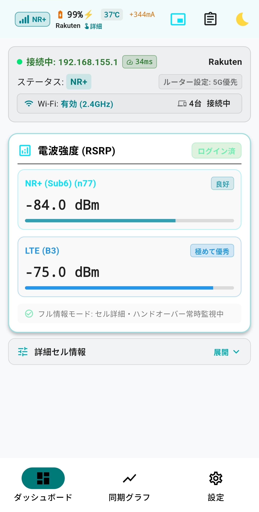
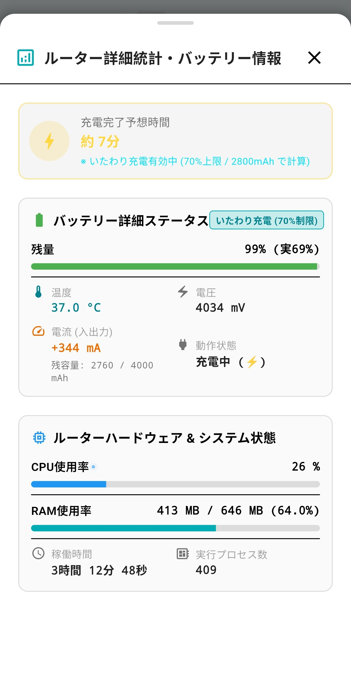
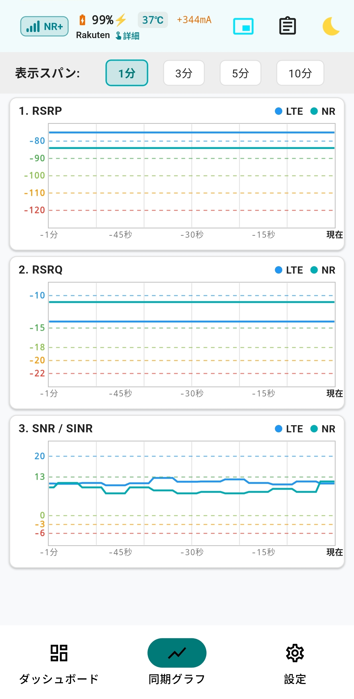
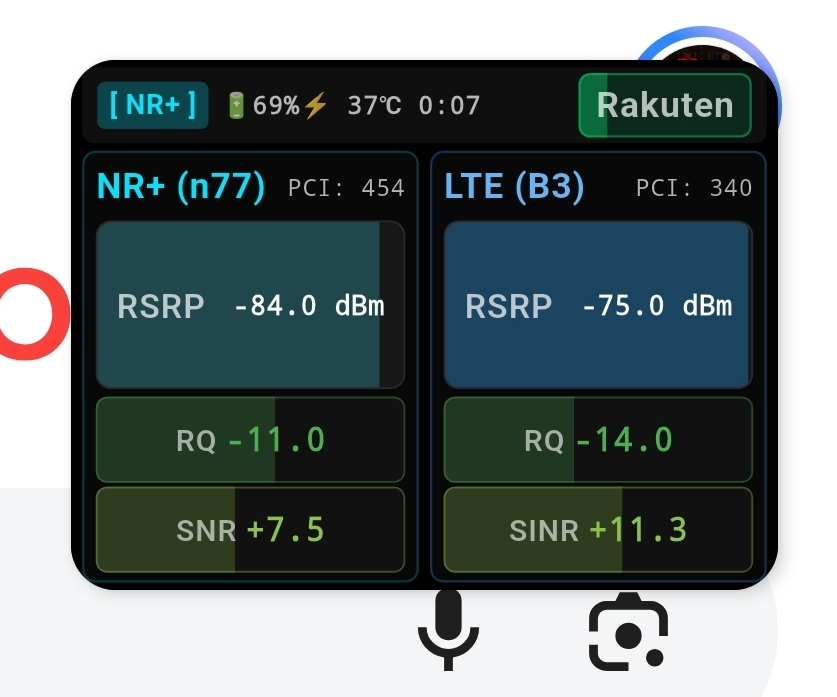
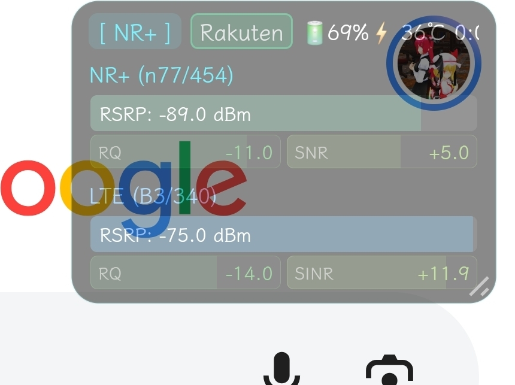
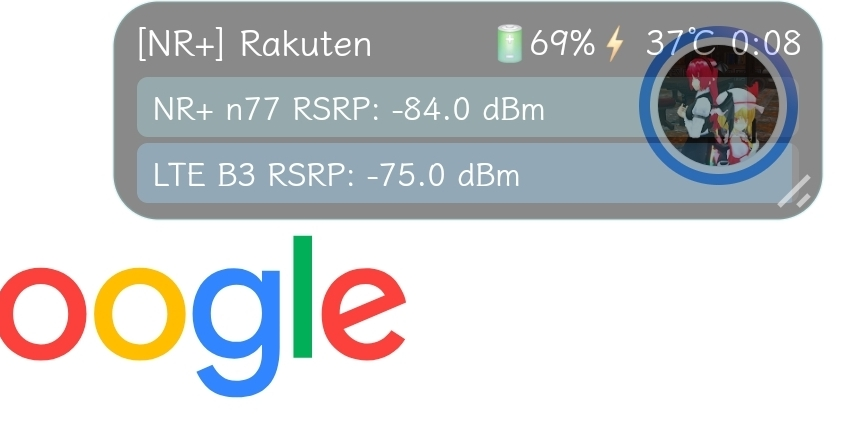
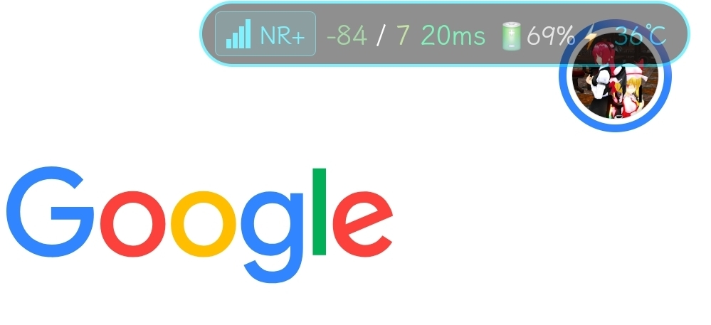

# +F FS050W Signal Display (FS050W 電波監視・エンジニアリング表示アプリ)

[-green.svg>)](https://www.android.com)
[](https://developer.android.com/compose)
[](https://m3.material.io/)

富士ソフト製 5G/4G モバイルルーター **「+F FS050W」** の電波状態・セル情報・バッテリー詳細・ハードウェア統計をリアルタイムに取得・可視化・常駐監視する Android アプリケーションです。

> **v3.0 以降は Kotlin / Jetpack Compose による完全ネイティブ実装です。** Material Design 3 と Material You（壁紙連動ダイナミックカラー）を採用しています。Flutter 版は git 履歴にのみ残ります。

---

## 📸 スクリーンショット

|                 機能                 |                       スクリーンショット                       |
| :----------------------------------: | :------------------------------------------------------------: |
|   **ダッシュボード & 共通AppBar**    |      |
| **バッテリー・システム詳細モーダル** |  |
|            **同期グラフ**            |     |
|               **PiP**                |       |
|            **HUD mode 1**            |     |
|            **HUD mode 2**            |     |
|          **HUD mode mini**           |   |

---

## 📱 主な機能

- **リアルタイム電波ダッシュボード**: 5G NR (SA/NSA/sub6) と 4G LTE の RSRP / RSRQ / SINR / SNR / Band / PCI / キャリアを 6 段階カラーゲージで表示
- **公式 API 認証**: CSRF トークン → prikey 取得 → HMAC-MD5 チャレンジレスポンスでログイン。認証状態に応じてポーリング間隔を切り替え（ログイン時 1〜5 秒／未ログイン時 3〜10 秒）
- **バッテリー & ハードウェア詳細**: 残量・温度・電圧・電流・いたわり充電（70%）考慮の残り稼働予測、CPU / RAM / 稼働時間 / プロセス数
- **4 連同期タイムシリーズグラフ**: RSRP / RSRQ / SNR / ルーター ping を同一時間軸に描画。ハンドオーバー自動マーカー、1/3/5/10 分のスパン切り替え
- **PiP & フローティングオーバーレイ**: 7 種アスペクト比、ドラッグ・端吸着・シングルタップ展開/折りたたみ・ダブルタップで復帰・リサイズ。オーバーレイも Material You に追従
- **イベントハプティクス & LED ランプ**: 5G+ 突入、ハンドオーバー、電波微弱、バッテリー高温を振動と画面上部 LED で通知（通知シェードは使用しません）
- **HUD モード**: OLED 向け漆黒全画面表示、焼き付き防止ジッター
- **セットアップウィザード**: Wi-Fi デフォルトゲートウェイの自動検出と接続テスト

---

## 🛠 動作環境

- **バージョン:** v3.0.0 (Release)
- **対象 OS:** Android 13 以上 (API 33+)
- **開発:** Kotlin / Jetpack Compose / Material 3 / AGP 9.1 / Java 17
- **対応ルーター:** 富士ソフト +F FS050W (Wi-Fi 接続)

---

## 🚀 ビルドとインストール

Java 17 と Android SDK Platform 36 を用意してください（`android/local.properties` に `sdk.dir` を設定）。

```bash
cd android
./gradlew :app:assembleDebug      # デバッグ APK
./gradlew :app:assembleRelease    # リリース APK (R8 minify + リソース縮小)
./gradlew testDebugUnitTest       # 単体テスト
```

生成物:

- `android/app/build/outputs/apk/debug/app-debug.apk`
- `android/app/build/outputs/apk/release/app-release.apk`

署名は既存の debug キーを使用するため、Flutter 版から上書き更新できます。

---

## 🔒 ログイン情報・バックアップ仕様

全設定（ルーター接続情報・パスワード・PiP/オーバーレイ設定・通知設定など）は Android の自動バックアップ（Google ドライブ連携）および端末間データ移行の対象です。Flutter 版から移行する場合、旧 `SharedPreferences` の設定は初回起動時に自動で読み込まれます。

初期化したい場合は **設定 → アプリ → FS050W Signal Display → ストレージとキャッシュ → ストレージを消去** を実行してください。

---

## GitHub Actions

- **Android CI**: PR / main push / 手動実行で単体テストと debug / release APK をビルドし Artifacts に保存
- **Android Preview Release**: CI 成功後に APK を既存キーで署名しドラフト Release を作成
- **Android Release**: main へのマージでバージョンを採番し、署名済み APK を正式 Release として公開

versionCode は `10000 + 2020-01-01 00:00:00 UTC からの経過秒数` です。共通 concurrency グループでビルドを直列化します。

---

## 📝 更新履歴

詳細は [CHANGELOG.md](CHANGELOG.md) をご覧ください。
